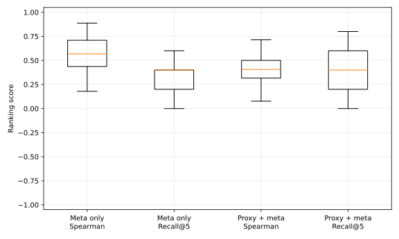

# MetaLearnML

[](https://github.com/Chunduri-Aditya/MetaLearnML/actions/workflows/ci.yml)

Choosing a pipeline for a new table costs many full cross validation runs, one for each candidate pipeline.
MetaLearnML tests whether a learned ordering of candidates can reach a good pipeline in fewer runs.

MetaLearnML is a meta-learning AutoML engine for supervised tabular data. It extracts
dataset and pipeline meta-features to rank preprocessing/model candidates, selects a
pipeline with development-only cross-validation, and reports performance once on an
untouched test partition.

The v2 implementation emphasizes reproducibility and testable evidence:

- typed, content-addressed candidate records;
- versioned meta-feature and experiment-history schemas;
- exact model identity plus model-family features;
- fold-local preprocessing and deterministic splits;
- independent registry, random, proxy, meta, and proxy+meta ordering;
- complete preprocessing/model bundles that accept raw DataFrames; and
- a pinned, leave-one-dataset-out benchmark with committed result rows and plots.

## Evidence

The published `balanced-15-v1` benchmark covers eight classification and seven
regression OpenML tasks, three outer seeds, five inner folds, and 28–36 candidate
pipelines. Exhaustive search is the reference only within that fixed candidate universe.

| Published result | Value |
|---|---:|
| Proxy+meta median quality retention at budget 10 | 100.0% |
| Proxy+meta median final-test normalized regret at budget 10 | 0.0 |
| Median evaluation reduction vs. random to regret ≤ 0.05 | 0.0% |
| Dataset-bootstrap 95% interval for that reduction | 0.0% to 50.0% |
| Candidate-run failures retained in denominators | 18 |

These values come directly from the committed [benchmark report](benchmarks/reports/benchmark.md)
and [aggregate summary](benchmarks/results/aggregate_summary.json). The confidence
interval does not establish a reliable reduction in evaluations, so this repository does
not claim a measured search speedup. The evidence-generated résumé outcome is available
in [resume_bullets.md](benchmarks/reports/resume_bullets.md).

No saving appears because random ordering already has median regret 0.001023 (`benchmarks/reports/benchmark.md` line 45, table "Ranking quality", row "Random"), so on this candidate set the learned ordering does not earn its cost.



## Supported scope

- Supervised tabular classification and regression
- Numeric and categorical feature columns, including missing values
- Binary and multiclass labels
- scikit-learn estimators and PyTorch MLP candidates in the registry
- Macro F1 by default for classification and R² by default for regression

Free-text feature columns are unsupported in v2 and cause an actionable error. Time
series, image, audio, multilabel, survival, and unsupervised tasks are outside the current
scope. Unseen categorical values are handled by fitted bundle preprocessors.

## Quick start

Python 3.11 and CPU execution are the supported defaults.

```bash
git clone https://github.com/Chunduri-Aditya/MetaLearnML.git
cd MetaLearnML
python3.11 -m venv .venv
source .venv/bin/activate
python -m pip install -r requirements-dev.txt
```

Try it on the bundled sample, the 150 row iris table from scikit-learn (about 10 seconds on CPU):

```bash
python main.py --autopilot examples/data/iris.csv --label species
```

The report lands in `experiments/reports/` and the selected pipeline in `saved_models/`.
Run your own CSV the same way:

```bash
python main.py --autopilot /path/to/table.csv --label target
```

The defaults reserve 20% for untouched testing, select with five-fold CV, use seed 42,
and enable proxy+meta ordering. Useful controls include:

```bash
python main.py \
  --autopilot /path/to/table.csv \
  --label target \
  --test-ratio 0.2 \
  --cv-folds 5 \
  --seed 42 \
  --ordering random \
  --no-use-proxy \
  --no-use-meta-learning \
  --max-candidates 10
```

Use `--exhaustive` to bypass candidate budgets and target-based stopping. The interactive
workflow remains available through `python main.py`.

## Evaluation contract

1. Raw rows are split into development and untouched test partitions before metadata or
   label encoders are fitted.
2. Classification uses a stratified outer split and `StratifiedKFold`; regression uses
   seeded random splitting and `KFold`.
3. Each preprocessing strategy is fitted separately inside each training fold.
4. PyTorch early stopping receives only a deterministic subset of that fold's training
   rows. The CV validation fold is scored once afterward.
5. After selection, the chosen pipeline is refitted on all development rows and evaluated
   once on test rows.

Reports keep `selection_cv_mean`, `selection_cv_std`, `test_score`, objective values, and
the direction-adjusted generalization gap separate. RMSE and MAE are displayed in their
natural positive form even though their internal objectives are maximized.

## Candidate and history schemas

A candidate is a structured model identity, preprocessing strategy, and training
configuration. Its full ID is the SHA-256 of canonical JSON; twelve characters are used
only as a display prefix. Human-readable preprocessing names are labels, not the source
of truth.

The meta-feature schema is deterministic and includes dataset metadata, exact model
identity, model family, and four preprocessing component blocks. Every block includes
explicit `none` and/or `unknown` values. A fitted meta-model stores the schema version,
schema hash, ordered features, registry snapshot, scaler, estimator, task, and metric;
incompatible artifacts fail safely.

Mutable production history remains ignored at `experiments/meta_train.csv`. Its committed
schema is [meta_train.schema.json](experiments/meta_train.schema.json). The non-overwriting
legacy migration command is:

```bash
python scripts/migrate_meta_history.py \
  --input experiments/legacy_meta_train.csv \
  --output experiments/meta_train_v2.csv
```

Missing columns fail validation. Invalid rows are summarized by reason, and training
fails if more than 5% are rejected or fewer than 20 valid rows remain.

## Loading a deployable bundle

Normal runs persist a directory containing the fitted preprocessor, fitted estimator or
state, label encoder, expected columns/types, candidate configuration, metric metadata,
and package/schema versions.

```python
import pandas as pd

from engine.predictor import BestModelPredictor

predictor = BestModelPredictor(bundle_path="saved_models/my_dataset_best_pipeline")
predictions = predictor.predict_dataframe(pd.DataFrame([{"age": 42, "segment": "new"}]))
```

The old results-CSV predictor constructor remains as a deprecated compatibility adapter.

## Reproducing the benchmark

Third-party datasets are not stored in this repository. The reviewed manifest and lock
pin OpenML task/dataset versions, targets, licenses, provider checksums, and local
snapshot SHA-256 values. Downloads go to the ignored `benchmarks/cache/` directory.

```bash
python -m pip install -r benchmarks/environment/requirements-lock.txt
make benchmark-fetch
make benchmark-smoke
make benchmark-full
make benchmark-report-check
```

`benchmark-smoke` is offline and generates two local fixtures. `benchmark-report-check`
regenerates evidence in a temporary directory and compares artifact hashes. The full
benchmark workflow is manual and sharded; it uploads results for review and never commits
or publishes changed evidence automatically.

The benchmark run recorded this evidence from a dirty working tree (`benchmarks/reports/benchmark.md` line 64), and `python -m benchmarks.run report-check` reproduces the committed hashes.

Committed evidence includes:

- [dataset manifest](benchmarks/datasets.yaml) and [reviewed lock](benchmarks/datasets.lock.json);
- [benchmark configuration](benchmarks/benchmark_config.yaml);
- the exact published [Python dependency lock](benchmarks/environment/requirements-lock.txt);
- compressed [candidate rows](benchmarks/results/candidate_results.csv.gz) and
  [method rows](benchmarks/results/method_results.csv);
- [per-dataset summary](benchmarks/results/per_dataset_summary.csv), aggregate JSON, and
  environment metadata;
- the [methodology/report](benchmarks/reports/benchmark.md); and
- deterministic figures in [benchmarks/figures](benchmarks/figures).

## Development and CI

```bash
make lint
make test
make benchmark-smoke
make benchmark-report-check
```

The default CI job runs Ruff, the service-free pytest suite with a 70% maintained-code
coverage gate, an end-to-end CPU search, the offline benchmark smoke profile, and the
deterministic evidence check. The live Neo4j test is opt-in:

```bash
RUN_NEO4J_TESTS=1 pytest -q tests/integration/test_neo4j.py
```

## Architecture

```text
raw table
  -> outer development/test split
  -> development-only metadata + label encoding
  -> canonical candidate universe
  -> registry/random/proxy/meta/proxy+meta ordering
  -> shared fold-local evaluator (sequential or parallel)
  -> selected candidate refit on development rows
  -> one untouched-test evaluation
  -> deployable bundle + schema-v2 history + reports
```

Key modules:

- `engine/meta_features.py` — canonical feature schema and compatibility hash
- `engine/meta_history.py` — validated schema-v2 experiment records
- `engine/splitting.py` — outer and inner split definitions
- `engine/candidate_evaluator.py` — shared fold and final evaluation
- `engine/search.py` — candidate generation, ordering, and sequential/parallel execution
- `engine/bundle.py` — complete pipeline persistence and raw-row reload
- `benchmarks/` — pinned data provenance, protocol, analysis, results, and figures

## Optional Neo4j and FastAPI components

Set `NEO4J_URI`, `NEO4J_USER`, and `NEO4J_PASSWORD` to enable additive graph logging.
Run the read API with:

```bash
make web
```

Graph records store candidate IDs, model identity/family, structured preprocessing,
objective/display metric values, and provenance. Ranking queries sort by the maximized
objective rather than by a natural metric whose direction may differ.

## Limitations

- Evidence applies only to the named 15-dataset suite, three outer seeds, and the fixed
  28–36-pipeline universe; it does not establish global model optimality.
- The published method runtime plot uses measured fold times with replay-equivalent
  ordering overhead. A separately controlled cold wall-clock study remains future work.
- Candidate failures are retained, but power transformation failed on
  [18 candidate runs](benchmarks/reports/benchmark.md) in the published evidence.
- Meta-ranking has a cold-start limitation when fewer than 20 compatible history rows
  exist.
- Text columns and non-tabular tasks are unsupported.

## License

This project uses the [MIT License](LICENSE).
